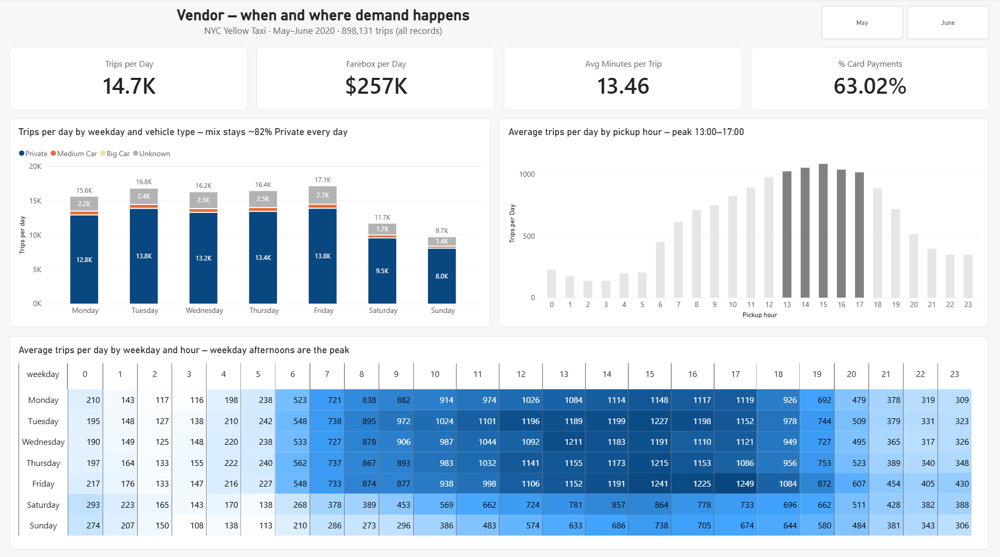
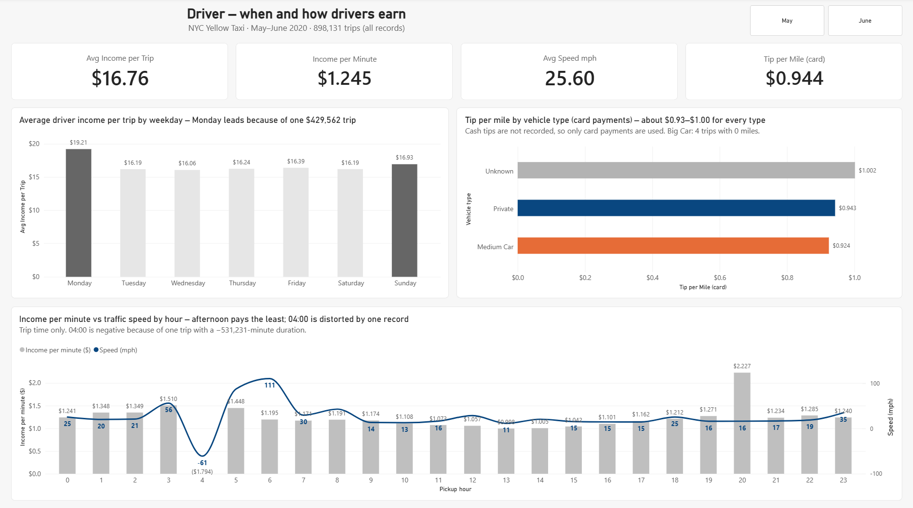
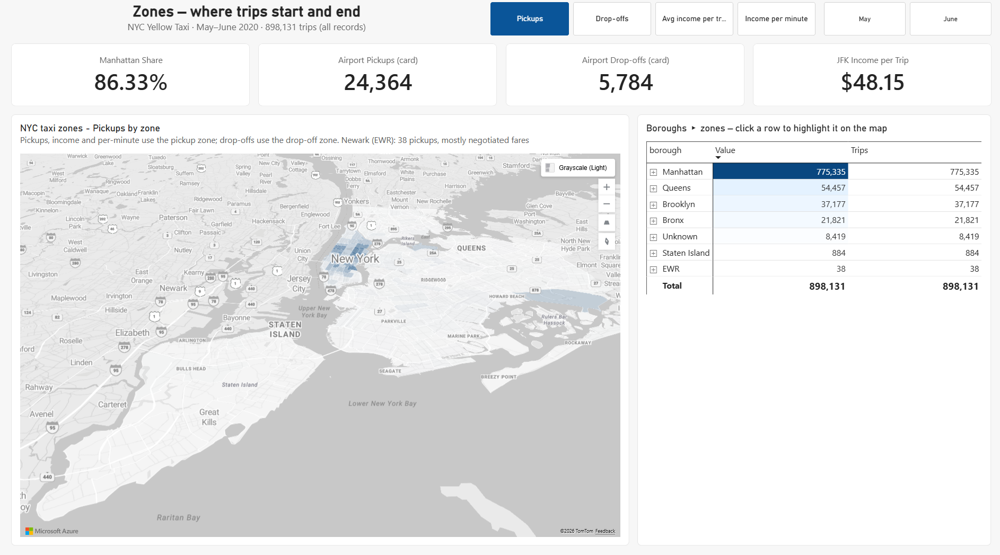
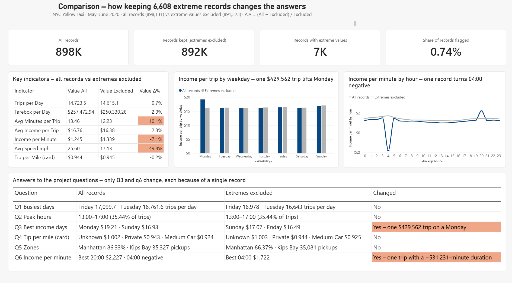

# NYC Yellow Taxi – Power BI analysis

Power BI report on **898,131 NYC yellow taxi trips (May–June 2020)** that answers
six business questions for two perspectives: **Vendor** (where and when demand
happens) and **Driver** (when and how drivers earn).
Every number is checked against a SQL Server query.

## Files

| File | Open |
|------|------|
| [Power BI report](report/nyc-yellow-taxi.pbix) | Download raw file → Power BI Desktop |
| [Presentation (PDF and PowerPoint)](presentation/) | PDF opens on GitHub; PowerPoint: download raw file |
| [SQL checks](sql/) | SSMS or read on GitHub |

## Answers

All records, as required by the project brief.

| # | Question | Answer |
|---|----------|--------|
| 1 | How are vehicle types distributed across weekdays? | The mix is stable: **Private 80.8–82.7%** every day. Busiest day Friday (17,099.7 trips per day), quietest Sunday (9,672.2). |
| 2 | Which 5 hours have the most trip starts? | **13:00–17:00**, with 35.44% of trips. Peak at 15:00 (1,085.2 trips per day). |
| 3 | Which 2 weekdays have the highest income per trip? | **Monday ($19.21) and Sunday ($16.93).** ⚠ Monday leads because of one $429,562 trip; without it, Sunday and Friday lead. |
| 4 | Which vehicle type gets the highest tip per mile? | **Unknown ($1.002)**, close to Private ($0.943) and Medium Car ($0.924). Card payments only: cash tips are not recorded. |
| 5 | *Own question:* Which zones generate the most trips? | **Manhattan, 86.33%** of pickups; top zone Kips Bay (35,327). Airports are 2.71% of pickups, but JFK pays **$48.15 per trip** vs $16.76 on average. |
| 6 | *Own question:* When does a driver earn most per minute? | **The afternoon pays least:** 13:00–17:00 earns $1.061 per minute vs $1.358 at other hours (slow traffic). ⚠ 04:00 (negative) and 20:00 (top) are distorted by single records. |

<b>Report pages (screenshots)</b>

Walkthrough of the pages without extreme values:

## Bonus: what the extreme values change

**6,608 records (0.74%)** have impossible values: negative fare, duration of 0
or less or over 5 hours, distance over 200 miles, fare over $1,000, or a date
outside May–June. They are **flagged, not deleted**. The report adds:

- **View B:** the same pages without these records (pages marked *excl.*)
- **View C:** a comparison page

**Result:** 4 of 6 answers do not change. Questions 3 and 6 change, each
because of **one single record**. Averages based on time and distance move most:
average speed +49.4%, minutes per trip +10.1%.

## Data and limitations

- Source: NYC TLC trip records, provided by NewTech Academy. 898,131 rows match TLC's official total (about 898,127).
- May–June 2020 is the post-lockdown recovery, so the results describe that period only.
- Cash tips are not recorded, and there is no driver or vehicle ID.
- The flag rules catch impossible values, not every suspicious one (for example, a $950 trip of 0.3 miles).
- Column definitions: [docs/data-dictionary.md](docs/data-dictionary.md)

## How it was built

Built by Angel Iana with an AI assistant (Claude, by Anthropic) used as a guide and reviewer.

| Angel Iana | AI assistant |
|------------|--------------|
| Project decisions, own questions, keeping all records plus the two extra views | Proposed cleaning rules, flag column and page structure |
| Ran and checked every SQL script | Wrote SQL scripts and drafted conclusions |
| Built the model, measures, all pages and the map; checked every number against SQL | Proposed DAX measures and layouts; reviewed screenshots |
| Final presentation, all commits | Drafted README, slide text and a model deck |

**Tools:** Power BI Desktop · Power Query · DAX · Azure Maps · SQL Server · mapshaper
**Sources:** [TLC data dictionary](https://www.nyc.gov/assets/tlc/downloads/pdf/data_dictionary_trip_records_yellow.pdf) · [TLC monthly indicators](https://www.nyc.gov/assets/tlc/downloads/csv/data_reports_monthly.csv) · [TLC taxi zones](https://www.nyc.gov/site/tlc/about/tlc-trip-record-data.page)
