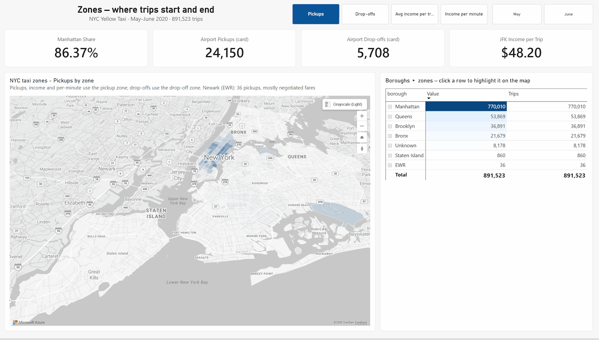
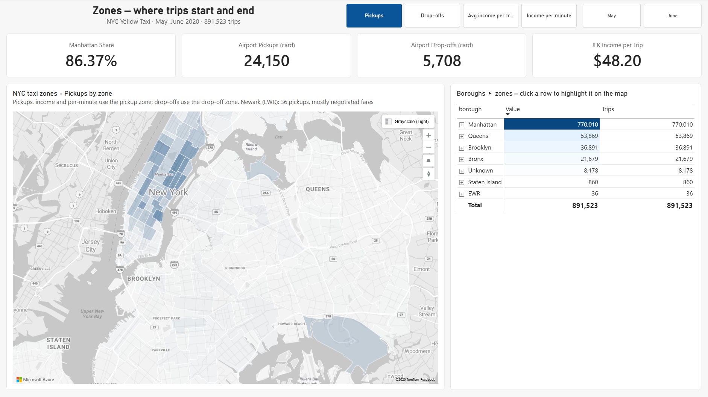
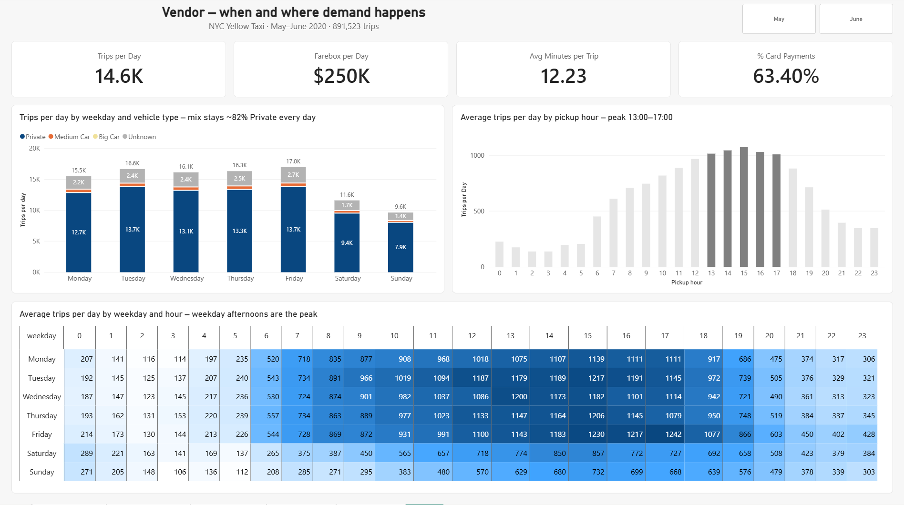
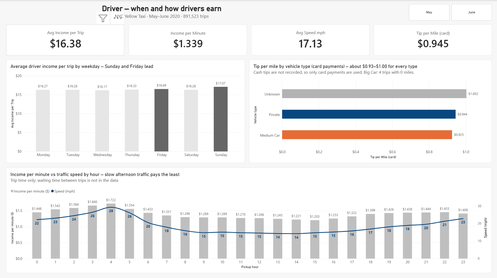

NYC Yellow Taxi – Power BI analysis
Analysis of 891,523 New York City yellow taxi trips from May–June 2020, from two
perspectives:
Vendor – where and when trips happen across the city
Driver – which days, hours and places earn the most
Every number below comes from a SQL Server query and matches the Power BI report.
> **Status:** the results below use the 891,523 trips left after excluding 6,608 records with extreme values (view B). A version on all 898,131 records (view A) and a comparison of the two (view C) are in progress; see `sql/09_all_vs_excluded.sql`.

How to open the files
File	What it is	How to open
Presentation (PDF)	10 slides with the answers and recommendations	Opens directly on GitHub
Presentation (PowerPoint)	Same slides, with speaker notes	Click Download raw file, open in PowerPoint
Power BI report	4 report pages plus check pages	Click Download raw file, open in Power BI Desktop
SQL scripts	Data checks and the queries behind every number	Open in SSMS or read on GitHub
Key findings
Perspective	Question	Answer
Vendor	How are vehicle types distributed across the days of the week?	The mix is almost the same every day: Private 80.8–82.6% of trips, Unknown 14.0–15.8%, Medium Car 3.1–3.6%; Big Car appears only 4 times. Per day, Friday (16,978 trips) and Tuesday (16,643) are the busiest and Sunday (9,594) the quietest.
Vendor	Which five hours of the day have the most trip starts, on average?	13:00–17:00, which together hold 35.4% of trips. 15:00 peaks with 1,076.8 trips per day. There is no morning rush: 07:00–09:00 hold only 4.2–5.1% each.
Vendor	Which boroughs and zones generate the most trips, and how much do the airports contribute?	Manhattan has 86.37% of pickups, and the top 10 zones have 35.14% (Kips Bay leads with 35,081). Airports are only 2.71% of pickups, but a JFK pickup earns the driver $48.20 on average, compared with $16.38 for all trips.
Driver	Which two weekdays have the highest average income per trip?	Sunday ($17.07) and Friday ($16.49). The gap between the best and the worst day (Wednesday, $16.17) is only $0.90 (5.5%).
Driver	Which vehicle type gets the highest tip per mile?	Tips per mile are similar for every type once only card payments are counted: Unknown $1.003, Private $0.944, Medium Car $0.925. See the note below.
Driver	At which hours of the day does a driver earn the most per minute of trip time?	04:00 is the best hour ($1.722 per minute) and 15:00 the worst ($1.203). The 13:00–17:00 window pays $1.248 per minute, compared with $1.390 for the other hours. Traffic explains it: average speed falls from 29.22 mph at 04:00 to 14.19 mph at 14:00.
Why the tip answer changed
On all trips, Unknown vehicles seemed to get much lower tips ($0.168 per mile)
than Medium Car ($0.616) and Private ($0.614). The TLC data dictionary states
that `tip_amount` includes only card tips, so cash tips are missing. With card
payments only, the difference disappears. The first result came from payment
type, not vehicle type.
Zones in detail
Borough	Drop-offs	Avg income per trip (pickups)	Income per minute
Manhattan	722,657	$14.17	$1.307
Brooklyn	62,030	$28.53	$1.259
Queens	55,679	$33.68	$1.567
Bronx	38,998	$27.47	$1.356
Staten Island	2,046	$66.15	$1.708
EWR (Newark)	532	$74.86	$9.348
Trips with an unknown zone (0.92%) are not shown. Manhattan has the volume; trips from the outer boroughs pay more per trip but
only a little more per minute. Newark is an outlier: only 36 pickups, and 24 of
them use a negotiated fare (RatecodeID 5) with almost no distance recorded.
Data
NYC Taxi & Limousine Commission (TLC) yellow taxi trip records, provided by
NewTech Academy: 898,131 trips in two monthly files, plus a lookup of 265 taxi
zones. The raw CSV files are not stored in this repository; the Power BI file
contains the imported data. Column meanings are in
docs/data-dictionary.md.
Check against official figures. TLC reports 11,237 trips per day in May 2020
and 18,326 in June 2020, about 898,127 trips in total. This matches the 898,131
rows loaded. After cleaning, the data has 11,153.2 and 18,192.4 trips per day.
May–June 2020 was the start of the recovery after the COVID-19 lockdown, so the
results describe that period and cannot be generalised to other years.
Industry indicators (TLC definitions), kept trips: 14,615.1 trips per day,
$250,330.28 farebox per day (without card tips), 12.23 minutes per trip, 55.65%
paid by card (63.40% of trips with a known payment type).
Data quality
The files were loaded into SQL Server and checked independently of Power BI.
Finding	Trips	Share
No vendor, passenger, rate code or payment data	109,608	12.2%
Distance of 0 miles	27,662	3.1%
0 passengers	22,912	2.6%
Impossible values (negative fare, duration ≤ 0 or > 5 h, distance > 200 mi, fare > $1,000, date outside May–June)	6,608	0.7%
The 6,608 trips with impossible values are excluded and the rest are kept, with
missing values shown as Unknown. Excluded rows are flagged, not deleted, so
every decision stays visible.
Limitations
Cash tips are not recorded, so tip results use card payments only.
Trip minutes cover pickup to drop-off; waiting time between trips is not in the data.
There is no vehicle or driver ID, so income per shift or per car cannot be calculated.
Report pages
Page	Content
Vendor	TLC indicators, trips per day by weekday and hour (heatmap), vehicle types by weekday
Driver	Income per trip by weekday, tip per mile by vehicle type, income per minute and speed by hour
Zones	Map of the 263 taxi zones with a metric selector (pickups, drop-offs, income per trip, income per minute) and a borough ▸ zone matrix
Checks	Each measure next to its SQL result



Repository structure
```
nyc-yellow-taxi-powerbi/
├── README.md
├── sql/             data checks and answers in SQL Server (scripts only, no data)
├── report/          Power BI file
├── presentation/    slides with answers and recommendations
├── images/          screenshots used in this README
└── docs/            data dictionary, taxi zone shapes (GeoJSON)
```
How this project was built
The project was built with an AI assistant (Claude, by Anthropic) used as a
step-by-step guide and reviewer.
Part	Angel Iana	AI assistant
Project decisions	Chose to check the data in SQL first and keep Power BI as the only report source; chose the two own questions (zones, income per minute)	Proposed the cleaning rules and thresholds
Industry context	Selected which indicators to use	Researched TLC reports and indicator definitions online
SQL	Ran every script in SSMS, checked each result and approved the conclusions	Wrote the scripts and drafted the conclusions from the results
Power BI	Built the model, measures and all report pages; checked every measure against SQL	Proposed DAX measures, page layouts and formatting; reviewed screenshots
Map	Converted the TLC zone shapefile to GeoJSON (mapshaper) and built the Azure Maps visual	Gave the conversion steps and checked the file
Presentation	Replaced the map images, adjusted the layout, checked every number and exported the final deck	Drafted the slide structure, text, speaker notes and a model deck
Documentation	Reviewed and approved all text	Drafted the README, data dictionary and data quality report
Version control	All commits and pushes	Step-by-step instructions
Tools
Power BI Desktop · Power Query (M) · DAX · Azure Maps · SQL Server · mapshaper
Sources
TLC – Yellow trip records data dictionary
TLC – Monthly indicators
TLC – Taxi zone shapefile